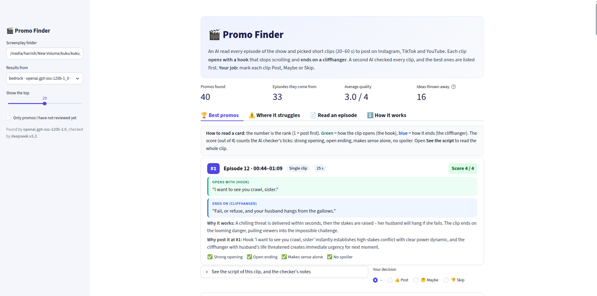
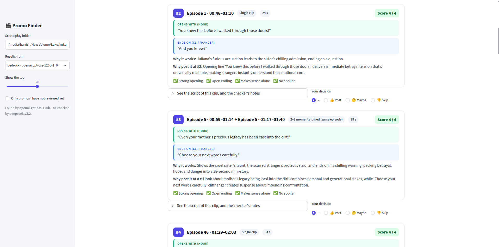
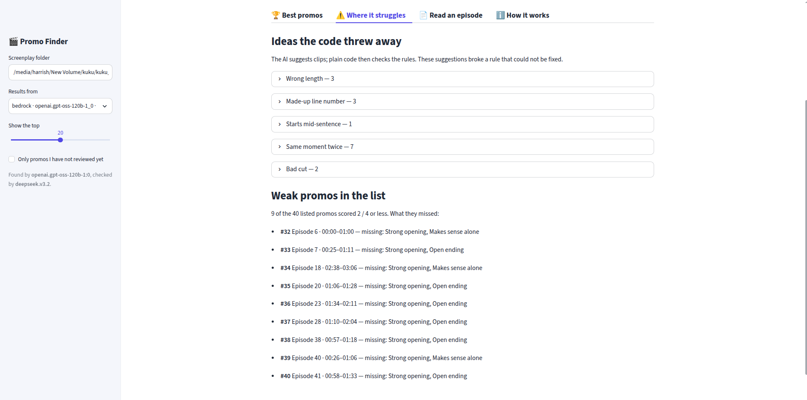
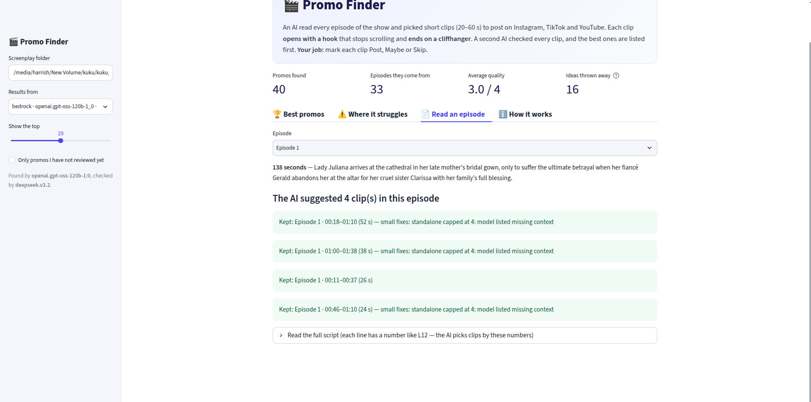
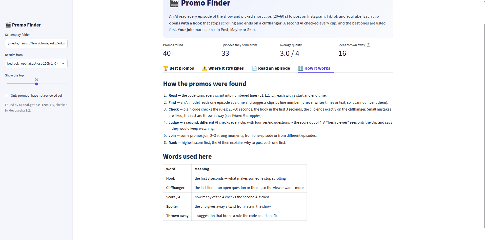

# Kuku AI Generalist Assignment — Solution Document

**Problem chosen:** Problem 1 — Find the Promos (Ads)
**Name:** _Harrish Bansal_  **Roll number:** _23119012_  **Branch:** _PNI_


---

## 1. The problem and how I framed it

An editor currently watches every 1–2 minute episode by hand and cuts **20–60 second promo clips** for Instagram,
TikTok and YouTube. A new show ships every week, so this is repetitive, judgment-heavy work that does not scale.

A good promo, per the brief, has three properties: it **opens on a hook** in the first 3 seconds, **ends on a
cliffhanger**, and **makes sense to a stranger** who has never seen the show. My tool reads the 50-episode
screenplay pack and produces a **ranked list of promos**, each with its episode, the start/end timestamp of every
segment, the hook line, the cliffhanger line, one line on why it works, and a note on why it is posted at that
position. It also reports, honestly, where it picks badly.

I scoped the task to exactly what the brief asks for — *finding* the moments and *ranking* them, not editing,
music or overlays — and built the pieces that make that trustworthy and repeatable.

## 2. The one design decision everything rests on

**The AI never writes a timestamp or a line of dialogue. It only picks line numbers.**

Every script line is parsed into a numbered event (`L12`) with a real start/end time. The model answers only with
IDs — "hook is `L12`, cliffhanger is `L30`" — and plain code then looks up the real text and the real times for
those IDs. This single choice removes the biggest risk with LLMs: it is now **impossible for the model to
hallucinate a timestamp or misquote the show.** The worst it can do is pick a weak line, and that is exactly the
kind of thing deterministic code can check. When the model does cite a line that does not exist, the code catches
it (5 such hallucinated IDs were caught in the full run, e.g. `L105`, `L40.5`).

The corollary is the division of labour: **AI does judgment, code owns every fact and every rule.** Anything
checkable — length, hook timing, "does it end on the cliffhanger", duplicates — is code. Only the subjective
calls — "is this a strong hook", "would a stranger keep watching" — go to a model.

## 3. How it works — the six steps

The pipeline (`run.py`, top to bottom) has six steps. Two use an AI model, and they are deliberately **two
different models** so that no model grades its own work.

1. **Read** (`promo/parse.py`, code) — turn each screenplay into numbered, timed lines.
2. **Find** (AI model #1, the *proposer*) — read **one episode at a time** plus a short "show bible" and propose
   promos by line number.
3. **Check and repair** (`promo/validate.py`, code) — look up the real lines and enforce the brief: 20–60 s,
   hook in the first 3 s, must end on the cliffhanger, cliffhanger must be dialogue or a real plot action (not a
   sound effect or a reaction shot). Small near-misses are **repaired and the repair is written down**; the rest
   are rejected with a reason.
4. **Judge** (AI model #2, the *critic*) — a different model answers yes/no quality checks and votes 2–3 times to
   cut noise; a separate "cold viewer" call sees **only the clip** (no context) and says whether a stranger would
   keep watching. This produces a **quality score of 0–4**.
5. **Join / stitch** (`promo/stitch.py`, AI model #1) — when the best hook and best cliffhanger are too far apart
   for one clip, join 2–3 moments from one episode (type B) or across episodes (type C). These go back through the
   same validator and critic.
6. **Rank** (`promo/rank.py`, code + AI model #2) — sort by quality first, break ties sensibly (clean openings
   before weak ones, non-spoilers first, earlier episodes first), remove duplicates, enforce variety (at most 3 of
   one story pattern in the top 10), and ask the model for a one-line "why post it here" on the top clips.

A small one-time **show bible** call (premise, characters, what a viewer knows by episode 5, and the list of
**late reveals**) gives every step shared context and, crucially, is how the tool detects **spoilers** — a promo
that gives away a late twist is flagged, while selling the early premise is allowed.

## 4. Features

- **Finds single-segment and stitched promos** — type A (one continuous stretch), type B (joined moments in one
  episode), type C (cross-episode trailer cuts).
- **Every promo is fully specified** — episode(s), per-segment start/end timestamps in order, hook line,
  cliffhanger line, why it works, and why it is posted at that rank.
- **Independent 0–4 quality score** from a second model, with a "fresh viewer" standalone test and majority voting
  to reduce noise.
- **Deterministic rule engine with auto-repair** — fixes clips that stop just short of their cliffhanger, trim
  over-length clips, move a late hook earlier, add a setup line to a too-short clip; each fix is recorded.
- **Spoiler detection** against an auto-generated show bible.
- **Honest failure reporting** — a "Where it struggles" view with every rejected idea grouped by reason, plus the
  weak promos that still made the list and what they are missing.
- **Human-in-the-loop review app** (Streamlit) — an editor marks each promo Post / Maybe / Skip; decisions are
  saved and used to measure real quality.
- **Model-agnostic** — any model is selected with one `provider/model` string; swap proposer or critic by editing
  one line of `config.toml` or passing `--model` / `--critic`.
- **Full caching and resumability** — every model answer is cached, so a crashed or quota-limited run resumes, and
  re-running rebuilds the whole show in seconds with no API key.
- **Multiple output formats** — `promos.md` (human), `promos.csv` (spreadsheet), `promos.json` (code), plus
  `rejected.json` and `run_stats.json`.
- **Offline mock model** (`--model mock`) and a built-in model smoke-test (`python -m promo.llm check <model>`).

## 5. Approach and scale

**What is AI vs. code.** Two LLM calls do judgment (find, judge); everything else — parsing, all rule checks,
repairs, deduplication, ranking, spreading episodes, variety limits — is plain, deterministic, free Python. This
keeps cost and non-determinism confined to two well-defined points.

**Human in the loop.** The tool ranks; a human makes the final call in the app. Those Post/Maybe/Skip verdicts are
saved and feed the quality measurement, so the system can be evaluated against real editorial taste rather than its
own score.

**Cost at real-world volume.** A full fresh run of the 50-episode show cost about **$0.07** of compute
(proposer `gpt-oss-120b` on Amazon Bedrock; the DeepSeek critic's price is not in the table, so it is listed, not
counted), roughly **$0.0014 per episode**. Episodes run six at a time; a full run takes ~10–20 minutes live and
**~49 seconds when rebuilding from cache**. The same setup runs on a completely free tier (Groq `gpt-oss-120b` /
`gpt-oss-20b`), just slower because of per-minute limits. At "a new show every week" this is comfortably cheap and
fast, and nothing about it is specific to one show.

**Easy model swap.** The entire pipeline talks to models through a single function, `ask_json(system, user)`, in
`promo/llm.py`. That file absorbs the real differences between providers (reasoning-token budgets, thinking text
leaking into replies, messy JSON, unsupported parameters, rate limits, auth errors) so that connecting a stronger
model — exactly what the brief says it may do at interview — is a one-line change. Built-in providers: OpenAI,
Anthropic, Groq, OpenRouter, Gemini, Bedrock, DeepSeek, Mistral, Together, Ollama (local), and a `custom` option
for any OpenAI-compatible endpoint.

## 6. Quality checking — real numbers and honest failures

From the full 50-episode run (`run_stats.json`):

| Metric | Value |
|---|---|
| Per-episode proposals + stitched proposals | 156 + 10 |
| Passed the code checks | 157 |
| Rejected by rules (with reasons) | 16 |
| Duplicates removed | 60 |
| Final ranked promos | 40, drawn from **33 of 50** episodes |
| Quality of the top 40 | 7 scored 4/4, 24 scored 3/4, 9 scored 2/4 (average **3.0 / 4**) |
| Spoilers in the top 10 | **0** |
| Weak openings in the top 10 | **0** |
| Hallucinated line IDs caught by code | 5 (e.g. `L105`, `L40.5`) |

**Where it picks badly (reported, not hidden).** The "Where it struggles" view groups every rejected idea by
cause — wrong length, made-up line number, starts mid-sentence, same moment twice, bad cut — and lists the 9 of 40
ranked promos that still scored only 2/4 and exactly which quality group they missed. This is the direct answer to
the brief's "where does your tool pick badly?".

**How I know the checks work.** The rules are covered by a test suite (`tests/`), and `eval/score.py` compares two
runs and counts concrete defects (clips running past the cliffhanger, clips ending on a sound effect, duplicates,
weak openings, spoilers) plus how many of the top 10 a human marked Post. Iterating against those counts is how the
earlier defects (clips over-running the cliffhanger, endings on sound effects, duplicate moments, vague openings)
were driven down to zero in the top promos.

## 7. Assumptions made (brief was silent)

- **Promo length 20–60 s, hook within the first 3 s** — taken directly from the brief and enforced as hard rules.
- **A cliffhanger must be spoken dialogue or a real plot action** (a strike, an arrest, a weapon, an arrival), not
  a sound effect or a reaction shot ("she gasps"), however dramatic the wording. This encodes how ReelShort /
  DramaBox ads actually end.
- **"Makes sense alone" is tested from a cold start** — a separate model call sees only the clip, no bible.
- **New viewers start at episode 1**, so selling the early premise is valuable and is explicitly *not* treated as a
  spoiler; only late reveals are.
- **One screenplay folder of `.txt` files = one show**; the tool reads any such folder, not just this one.

## 8. Where it fails / limits (honest)

- It reads **only the script**, so a purely visual hook (a look, a costume, a set) can be under- or over-scored.
- The **critic is also an AI** and can be wrong; that is exactly why the human Post/Maybe/Skip step exists and is
  measured.
- **Cross-episode (type C) promos** usually repeat a moment a normal promo already uses, so most are removed as
  duplicates — in this run none survived into the top 40 (the 2 stitched promos in the top 20 are type B).
- The list of "real action" verbs that lets an action line end a promo is **hand-written**, so an unusual phrasing
  could slip through or be wrongly rejected.
- The **show bible is AI-generated from loglines** and can contain small inaccuracies; it is used as guidance only,
  never as a source of the facts that end up in a promo.

## 9. How to run

```bash
# install (Python 3.11+)
python3 -m venv .venv && .venv/bin/pip install -r requirements.txt

# rebuild results from the cached answers (no API key needed)
python run.py --input "../I Married a Broken Soldier. He was a Duke"

# open the review app
.venv/bin/streamlit run app.py

# use a different model (one line, or a flag)
python run.py --input "<folder>" --model groq/openai/gpt-oss-120b --critic groq/openai/gpt-oss-20b

# test offline, no key
python run.py --input "<folder>" --model mock
```

---

## Appendix: the prototype

**A. Ranked promos and the review screen.** Top-of-page summary (40 promos, 33 episodes, average 3.0/4, 16 ideas
thrown away) and the top promo, Episode 12, scoring 4/4. Each card shows the hook (green), the cliffhanger (blue),
why it works, why it is posted at that rank, the four critic ticks, and the Post / Maybe / Skip control.



**B. The ranked list, including a stitched promo.** Promo #3 is a type-B clip that joins two moments from Episode 5
into a 38-second mini-story.



**C. Where it struggles.** Every rejected idea grouped by cause (wrong length, made-up line number, starts
mid-sentence, same moment twice, bad cut), and the weak promos that still made the list with what they are missing.



**D. Read an episode.** Any episode's logline, the clips the AI suggested there, the small fixes the code applied,
and the full numbered script — so every decision is traceable to the source lines.



**E. How it works (in the app).** The six steps and the vocabulary, shown to a first-time viewer.


